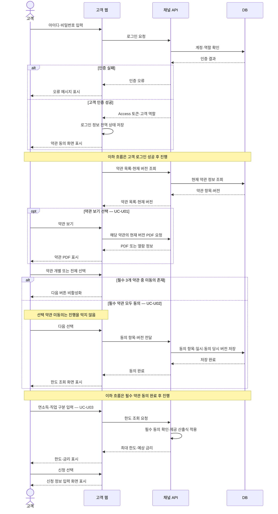
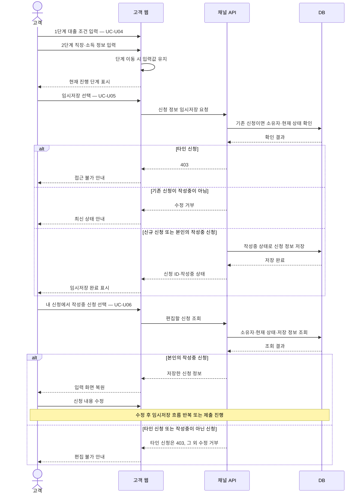
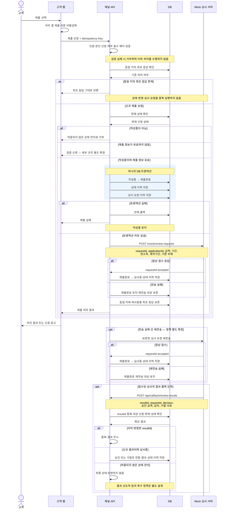
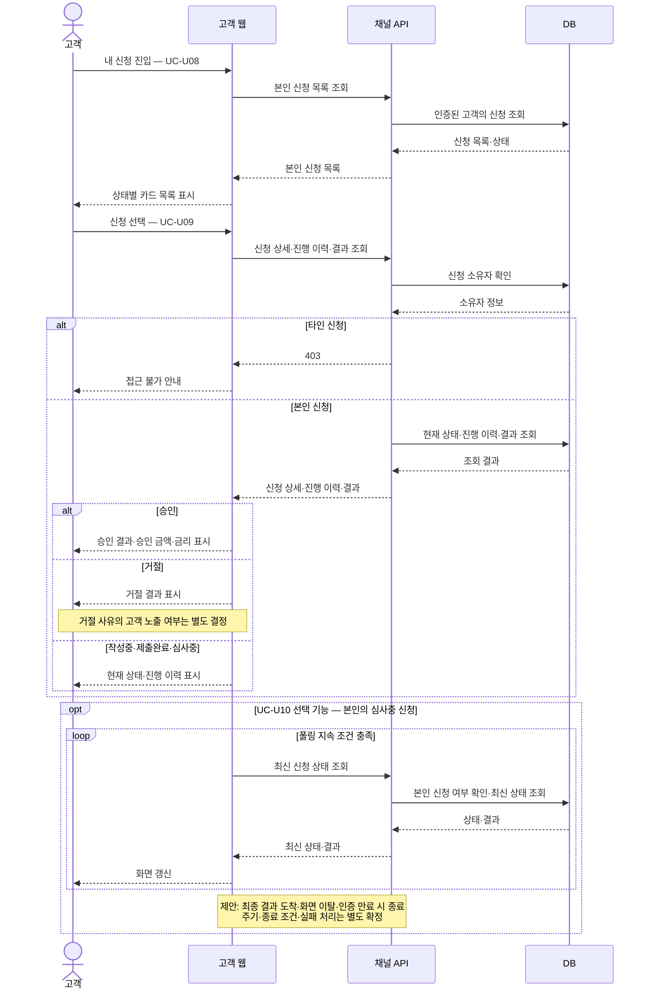

# 비대면 대출 신청 시스템 유스케이스

## 1. 문서 목적과 범위

`loan-channel-assignment.pdf`의 사용자·역할, 업무 흐름, 상태 정의, 기능·기술·분석 요구사항을 기준으로 고객과 채널 운영자가 수행할 수 있는 유스케이스를 정리한다.

- **사용자**: 대출을 신청하는 고객을 의미한다.
- **운영자**: 채널 운영자로, 신청 현황·통계를 조회하고 약관 PDF를 관리한다.
- **외부 시스템**: Mock 심사 서버가 심사를 수행하고 접수 응답 및 결과 콜백을 전달한다.
- **우선순위**: 결과 새로고침(폴링, FR-12)만 선택 사항이며, 나머지 명시된 기능은 필수다.
- **제외 범위**: 회원가입, 본인인증, 전자서명, 실제 심사 로직, 대출 실행·상환.

근거 표기의 `FR`은 원문 8절 기능 요구사항, `TR`은 9절 기술 요구사항을 의미한다. 원문에서 정하지 않은 사항은 9절에, 각 유스케이스의 구체적인 예외 흐름은 11절에 정리한다.

## 2. 역할과 권한

| 구분 | 고객 | 채널 운영자 |
| --- | --- | --- |
| 사용 환경 | 휴대폰 폭 390px 기준 모바일 웹 | PC 웹 |
| 로그인 후 이동 | 약관 동의 | 운영자 대시보드 |
| 신청 등록 | 본인 신청 등록 가능 | 운영자 권한으로 신청 등록하는 기능은 명시되지 않음 |
| 신청 수정 | 본인의 작성중 신청만 가능 | 불가 |
| 신청 조회 | 본인 신청만 가능 | 전체 신청 현황 조회 가능 |
| 심사·승인·거절 처리 | 직접 처리 불가 | 직접 처리 불가 |
| 통계 조회 | 제공되지 않음 | 기간별 KPI·퍼널·추이·평균 결과 소요시간 조회 |
| 약관 열람 | 동의 화면에서 현재 버전 PDF 열람 | 현재 버전 관리 및 이전 버전 PDF 열람 |
| 약관 교체 | 불가 | PDF 업로드로 새 버전 등록 가능 |

고객이 타인 신청을 조회·수정하면 403으로 차단한다. 운영자의 전체 신청 조회는 원문 4절에서 별도로 부여한 권한이며, 신청 수정 권한까지 포함하지 않는다. 운영자 기능은 운영자 역할만 접근할 수 있다. (원문 4절, TR-02)

## 3. 전체 업무 흐름

1. 고객이 제공된 테스트 계정으로 로그인한다.
2. 현재 약관 PDF를 확인하고 필수 약관에 동의한다.
3. 연소득·직업 구분을 입력하여 예상 한도와 금리를 조회한다.
4. 대출 조건과 직장·소득 정보를 입력한다. 임시저장한 신청은 나중에 이어 쓸 수 있다.
5. 고객이 신청을 제출하면 제출완료 상태로 저장하고 외부 심사 요청을 전송한다.
6. Mock 서버가 요청을 접수하면 심사중으로 전환한다.
7. Mock 서버의 결과 콜백을 받아 승인 또는 거절로 전환한다.
8. 고객은 내 신청에서 상태·진행 이력·결과를 확인한다.

운영자는 별도 대시보드에서 전체 신청과 통계를 조회하고 약관 버전을 관리한다. 고객의 신청 내용을 변경하거나 심사 결정을 내리는 단계에는 참여하지 않는다.

## 4. 공통 유스케이스

### UC-C01. 로그인

- **행위자**: 고객, 운영자
- **사전 조건**: 제공된 고객 또는 운영자 테스트 계정이 존재한다.
- **기본 흐름**: 아이디·비밀번호 입력 → 인증 → 역할 확인 → 고객은 약관 동의, 운영자는 대시보드로 이동한다.
- **결과**: 로그인 정보가 전역 상태로 관리되고, 역할에 맞는 기능을 사용할 수 있다.
- **예외 흐름**: 인증 실패 시 오류 메시지를 표시한다. 인증 처리 중에는 중복 조작을 막도록 버튼을 비활성화한다.
- **관련 요구사항**: FR-01, FR-11, TR-01, TR-04

### UC-C02. 처리 상태와 오류 확인

- **행위자**: 고객, 운영자
- **기본 흐름**: 요청 처리 중 버튼 비활성화 → 성공 시 결과 표시 → 실패 시 오류 메시지 표시.
- **시스템 규칙**: 공통 오류 응답은 코드·메시지·traceId를 포함한다. 모든 요청에 traceId를 부여하여 로그에 기록하고 응답 헤더로 반환한다.
- **관련 요구사항**: FR-11, TR-08, TR-11

## 5. 고객 유스케이스

| ID | 유스케이스 | 사전 조건 | 기본 흐름 및 결과 | 예외·제약 | 근거 |
| --- | --- | --- | --- | --- | --- |
| UC-U01 | 약관 PDF 열람 | 고객 로그인, 약관 동의 화면 진입 | 약관 항목의 ‘보기’를 선택하여 해당 약관의 현재 버전 PDF 확인 | 고객의 과거 버전 탐색 기능은 명시되지 않음 | FR-13 |
| UC-U02 | 약관 동의 | 고객 로그인 | 필수 3개·선택 1개 약관을 개별 또는 전체 선택 → 다음 단계 진행 → 동의 항목·일시·동의 당시 버전 저장 | 필수 항목 미동의 시 다음 버튼 비활성화. 선택 항목 미동의만으로 진행을 막지 않음 | FR-02, FR-03, FR-16, 원문 7절 |
| UC-U03 | 대출 한도 조회 | 필수 약관 동의 완료 | 연소득·직업 구분 입력 → 제공된 산출식으로 계산 → 최대 한도·예상 금리 확인 → 신청 버튼으로 입력 단계 이동 | 신용정보 조회 동의가 필요하므로 약관 동의보다 먼저 진행할 수 없음 | FR-04, 원문 5·7절 |
| UC-U04 | 신청 정보 입력 | 한도 조회 후 신청 진행 | 1단계 대출 조건 입력 → 2단계 직장·소득 입력. 진행 단계를 표시하고 단계 이동 시 입력값 유지 | 입력값의 세부 검증 범위는 별도 설계 필요 | FR-05, TR-04 |
| UC-U05 | 신청 임시저장 | 본인의 신청 정보 입력 중 | 임시저장 선택 → 작성중 상태로 저장 → 내 신청에서 확인 | 타인 신청 저장·수정 불가. 신청 내용 수정은 작성중에만 허용 | FR-06, TR-02, 원문 6절 |
| UC-U06 | 작성중 신청 이어쓰기·수정 | 본인의 작성중 신청 존재 | 내 신청에서 대상 선택 → 저장한 정보 불러오기 → 내용 수정 → 임시저장 또는 제출 | 제출완료·심사중·승인·거절 신청은 수정 불가 | FR-06, 원문 4·6절 |
| UC-U07 | 신청 제출 | 본인의 작성중 신청, 제출에 필요한 정보 입력 완료 | 제출 선택 → 제출완료로 변경 → 상태·심사 요청 이력 저장 → Mock 서버에 심사 요청 전송 | 중복 제출은 최초 응답 재사용. 전송 실패 시 제출완료 유지 및 재전송 대상 보존 | FR-07, TR-03, TR-05, TR-06, 원문 10절 |
| UC-U08 | 내 신청 목록 조회 | 고객 로그인 | 본인 신청을 상태별 카드 목록으로 확인 | 타인 신청 접근은 403 | FR-08, TR-02, 원문 7절 |
| UC-U09 | 신청 상세·진행 이력·결과 조회 | 본인 신청 존재 | 신청 선택 → 현재 상태와 진행 이력 확인 → 승인 시 승인 금액·금리, 거절 시 거절 결과 확인 | 결과를 직접 수정하거나 승인·거절을 결정할 수 없음 | FR-08, 원문 6절 |
| UC-U10 | 심사 결과 새로고침 | 본인의 심사중 신청 존재 | 폴링으로 최신 상태 조회 → 결과 도착 시 화면 갱신 | **선택 기능**. 폴링 주기·종료 조건은 별도 설계 필요 | FR-12 |

### UC-U07 상세: 제출과 중복·실패 처리

1. 고객이 제출 버튼을 선택한다. 처리 중에는 버튼을 비활성화한다.
2. 제출 요청에 `Idempotency-Key` 헤더를 포함한다.
3. 서버가 본인 신청 여부와 허용된 상태 전이인지 확인한다.
4. 상태 변경, 상태 이력, 심사 요청 이력을 하나의 트랜잭션으로 처리한다. 이 중 하나라도 실패하면 전체 롤백한다.
5. 외부 Mock 서버에 심사 요청을 전송한다.
6. 요청 접수 응답을 받으면 심사중으로 전환한다. 전송 실패 시 제출완료로 남겨 재전송 대상으로 관리한다.
7. 같은 키로 다시 제출 요청이 들어오면 최초 응답을 그대로 반환하고 중복 처리하지 않는다.

DB 트랜잭션 실패의 전체 롤백(TR-05)과 외부 전송 실패 시 제출완료 유지(원문 10절)는 구분하여 구현해야 한다. 외부 전송과 DB 처리의 구체적인 구성 방식은 원문에서 정하지 않았다.

## 6. 운영자 유스케이스

| ID | 유스케이스 | 사전 조건 | 기본 흐름 및 결과 | 예외·제약 | 근거 |
| --- | --- | --- | --- | --- | --- |
| UC-O01 | 기간별 KPI 조회 | 운영자 로그인 | 시작일·종료일 설정 → 한도 조회 수와 신청 제출 수 확인 | 기간 필터는 모든 지표에 적용 | FR-09, 원문 11절 |
| UC-O02 | 신청 퍼널·이탈률 조회 | 운영자 로그인 | 기간 설정 → 약관 동의·한도 조회·신청 생성·신청 제출의 단계별 고유 고객 수와 이탈률 확인 | 단계별 인원은 신청 건수가 아닌 고유 고객 수 | FR-09, 원문 11절 |
| UC-O03 | 일자별 신청 추이 조회 | 운영자 로그인 | 기간 설정 → 일자별 제출 건수를 차트로 확인 | 신청 생성일이 아닌 제출일 기준 | FR-09, 원문 11절 |
| UC-O04 | 평균 결과 소요시간 조회 | 운영자 로그인 | 기간 설정 → 제출부터 결과 수신까지 걸린 평균 시간 확인 | 미수신 건 처리와 기간 귀속 기준은 별도 정의 필요 | 원문 11절 |
| UC-O05 | 전체 신청 현황·상태별 목록 조회 | 운영자 로그인 | 전체 신청 현황 확인 → 상태 필터 선택 → 해당 상태 신청 목록 확인 | 신청 내용 수정 불가. 승인·거절 직접 처리 불가 | FR-10, 원문 4절 |
| UC-O06 | 약관 목록·현재 버전 확인 | 운영자 로그인 | 약관 관리 진입 → 약관별 목록 및 현재 버전 확인 | 운영자만 접근 가능 | 원문 7절, TR-02 |
| UC-O07 | 약관 PDF 교체 | 운영자 로그인, 대상 약관 존재 | 약관 선택 → PDF 업로드 → 파일 검증 → 새 버전 등록 및 현재 버전 변경 → 이전 버전 보관 | PDF 형식·확장자·용량 검증 실패 시 거부. 교체 트랜잭션 실패 시 이전 현재 버전 유지 | FR-14, TR-12, TR-13 |
| UC-O08 | 약관 버전 이력 조회 | 운영자 로그인, 대상 약관 존재 | 약관 선택 → 버전·등록자·등록 일시 목록 확인 | 이전 버전을 이력으로 보존 | FR-15 |
| UC-O09 | 이전 버전 약관 PDF 열람 | 운영자 로그인, 이전 버전 존재 | 버전 이력에서 대상 선택 → 해당 버전 PDF 확인 | 이전 버전 삭제·수정·복원 기능은 명시되지 않음 | FR-15 |

### UC-O07 상세: 약관 교체와 이력 보존

1. 운영자가 교체할 약관과 업로드할 PDF를 선택한다.
2. 서버가 확장자와 실제 파일 형식을 모두 확인하고 용량 제한을 검사한다.
3. 저장 파일명은 서버가 새로 생성한다.
4. 새 버전 등록과 이전 버전의 현재 버전 해제를 한 트랜잭션으로 처리한다.
5. 성공하면 고객의 약관 ‘보기’에 새 현재 버전을 제공하고, 이전 버전은 이력으로 보관한다.
6. 실패하면 이전 버전이 현재 버전으로 유지된다.
7. 기존 고객의 동의 이력에는 동의 당시 약관 버전을 유지한다. 현재 버전 교체로 과거 동의 버전을 덮어쓰지 않는다.

### 운영 지표 정의

| 지표 | 원문 기준 |
| --- | --- |
| 한도 조회 수 | 선택 기간의 한도 조회 수. 상세 집계 단위는 별도 확정 필요 |
| 신청 제출 수 | 선택 기간의 신청 제출 수 |
| 퍼널 단계별 인원 | 약관 동의 → 한도 조회 → 신청 생성 → 신청 제출의 단계별 고유 고객 수 |
| 단계별 이탈률 | `1 - (다음 단계 인원 / 현재 단계 인원)` |
| 일자별 신청 추이 | 일자별 제출 건수 |
| 평균 결과 소요시간 | 제출 시각부터 결과 수신 시각까지의 평균 |

모든 지표는 Oracle SQL 집계·분석 함수로 계산하고 대시보드에 시각화한다. 시작일~종료일 필터를 모든 지표에 적용하고, 분모와 기준 시각 등 지표 정의를 쿼리 주석에 작성한다.

## 7. 시스템·외부 연동 유스케이스

아래 항목은 고객·운영자가 직접 조작하는 기능이 아니라, 신청 이후 시스템이 수행하는 처리다.

| ID | 유스케이스 | 흐름과 결과 | 근거 |
| --- | --- | --- | --- |
| UC-S01 | 심사 요청 전송·접수 | 채널계가 `POST /mock/review-requests`로 requestId, applicationId, 금액, 기간, 연소득, 재직기간, 기존 부채 전송 → Mock의 requestId·accepted 접수 응답 확인 → 심사중 전환 | FR-07, 원문 5·6·10절 |
| UC-S02 | 전송 실패 건 재전송 대상으로 유지 | 전송 실패 시 제출완료 유지 → 재전송 대상으로 남김 → 재전송 후 접수되면 심사중 전환 | 원문 6·10절 |
| UC-S03 | 심사 결과 수신 | `POST /api/callback/review-results`로 resultId, requestId, decision, 승인 금액, 금리, 거절 사유 수신 → 해당 신청을 승인 또는 거절로 전환 → 상태 이력 저장 | TR-03, TR-07, 원문 10절 |
| UC-S04 | 중복 결과 무시 | resultId로 중복 판별 → 동일 결과는 상태와 이력에 한 번만 반영 | TR-07, 원문 10절 |

외부 연동 송수신마다 요청·응답 본문, 결과 코드, 소요시간을 기록한다. 연소득·주민번호 등 민감정보는 원문 그대로 로그에 남기지 않고 마스킹한다. (TR-09, TR-10)

## 8. 신청 상태와 허용 행동

| 현재 상태 | 가능한 행동·이벤트 | 다음 상태 | 주체 |
| --- | --- | --- | --- |
| 작성중 | 입력 수정·임시저장 | 작성중 유지 | 고객 |
| 작성중 | 신청 제출 | 제출완료 | 고객 요청을 처리하는 채널계 |
| 제출완료 | 심사 요청 접수 | 심사중 | 외부 접수 응답을 처리하는 채널계 |
| 제출완료 | 전송 실패 및 재전송 | 접수 전까지 제출완료 유지 | 채널계 |
| 심사중 | 승인 회신 | 승인 | 외부 결과 콜백을 처리하는 채널계 |
| 심사중 | 거절 회신 | 거절 | 외부 결과 콜백을 처리하는 채널계 |
| 승인·거절 | 조회 | 최종 상태 유지 | 고객·운영자 각 조회 권한 범위 |

- 승인·거절은 최종 상태다.
- 원문 상태도에 없는 전이(예: 승인 → 작성중)는 예외 처리한다.
- 상태 변경 시 이전 상태·다음 상태·변경 주체를 이력에 남긴다.
- 고객의 상태 변경 요청은 작성중 → 제출완료까지만 허용한다.
- 고객의 내용 수정은 작성중에만 가능하며 운영자는 신청 내용을 수정할 수 없다.

## 9. 원문에서 정하지 않은 설계 사항

다음은 확정된 요구사항으로 취급하지 않고 설계 시 별도로 결정한다.

| 항목 | 확인·결정할 내용 |
| --- | --- |
| 입력 검증 | 금액·기간·소득 등의 허용 범위, 필수 필드, 임시저장 시 검증 수준 |
| 약관 동의 시점의 버전 | **결정**: 약관 교체에 따른 재동의와 열람 후 버전 변경 처리는 고려하지 않는다. 동의 이력에는 화면에 제공한 버전을 기록한다(erd.md 9절) |
| 약관 업로드 | 최대 파일 용량, 저장 위치, 파일 접근 방식 |
| 재전송 정책 | 자동·수동 여부, 주기, 최대 횟수. 운영자용 수동 재전송 버튼은 요구사항에 없음 |
| 결과 표시 | 거절 사유는 콜백 필드에 있지만 고객 화면 노출 여부는 FR-08에 명시되지 않음 |
| 운영자 신청 조회 | 전체 현황 목록 외 개별 상세 화면과 노출 필드 범위 |
| 분석 경계 조건 | 기간 포함 범위·기준 시각, 한도 조회 수 집계 단위, 퍼널의 기간 간 고객 귀속, 분모 0 처리, 미수신 건의 평균 계산 처리 |
| 선택 기능 | 폴링 간격·종료 조건·실패 처리 |
| 추가 기능 | 로그아웃, 신청 취소·삭제, 계정 관리, 약관 항목 생성·삭제는 원문에 명시되지 않음 |

## 10. 기능 요구사항 추적표

| 요구사항 | 대응 유스케이스 |
| --- | --- |
| FR-01 로그인 | UC-C01 |
| FR-02 약관 체크 | UC-U02 |
| FR-03 동의 이력 | UC-U02 |
| FR-04 한도·금리 | UC-U03 |
| FR-05 단계형 입력 | UC-U04 |
| FR-06 임시저장·이어쓰기 | UC-U05, UC-U06 |
| FR-07 제출·심사 요청 | UC-U07, UC-S01 |
| FR-08 신청 목록·상세·결과 | UC-U08, UC-U09 |
| FR-09 KPI·퍼널·추이 | UC-O01, UC-O02, UC-O03 |
| FR-10 상태별 신청 목록 | UC-O05 |
| FR-11 처리 중·오류 표시 | UC-C02 및 요청을 수행하는 각 유스케이스 |
| FR-12 결과 폴링(선택) | UC-U10 |
| FR-13 현재 약관 PDF | UC-U01 |
| FR-14 약관 PDF 교체 | UC-O07 |
| FR-15 버전 이력·이전 PDF | UC-O08, UC-O09 |
| FR-16 동의 당시 버전 | UC-U02, UC-O07의 이력 보존 규칙 |

평균 결과 소요시간(UC-O04), 단계별 이탈률(UC-O02)은 FR 표 외 원문 11절의 분석 요구사항도 반영한 항목이다.

## 11. 유스케이스별 상세 예외 흐름

### 11.1. 표기와 공통 적용 기준

- **[요구]**: PDF에 명시된 제약·처리 규칙이다. 관련 FR·TR 또는 원문 절을 함께 표기한다.
- **[제안]**: 요구사항을 구체화하기 위한 처리안이며, PDF에서 확정한 정책은 아니다. 오류 문구, HTTP 상태 코드, 재시도 방식 등은 구현 전에 확정한다.
- 표의 안내 문구는 사용자에게 보여줄 메시지의 예시다. 서버 응답을 받지 못한 통신 장애에서는 traceId가 없을 수 있다.
- 아래 공통 예외는 인증이 필요한 모든 고객·운영자 유스케이스에 적용한다. 외부 콜백 인증 방식은 별도 설계 사항으로, 고객 로그인 정책을 그대로 적용하지 않는다.

| 공통 상황 | 발생 조건 | 처리 및 사용자 안내 | 처리 후 상태 | 구분 |
| --- | --- | --- | --- | --- |
| 인증 만료·누락 | 보호된 기능 요청에 Access 토큰이 없거나 만료·변조됨 | 요청을 거부하고 ‘로그인이 필요합니다’ 안내 후 재로그인 유도. Refresh 토큰에 의한 자동 갱신은 제공하지 않음 | 거부한 요청으로 데이터 변경 없음. 미저장 입력의 재로그인 후 복원 여부는 별도 결정 | [요구] TR-01의 Access 토큰만 사용, [제안] 화면 이동·응답 정책 |
| 권한 없음 | 고객이 운영자 API를 직접 호출하거나 타인의 신청 ID로 조회·수정 시도 | 서버에서 권한 검증. 타인 신청은 403, 운영자 기능의 무권한 요청도 거부 | 보호 대상 데이터는 반환·수정하지 않음 | [요구] TR-02 |
| 통신 실패·응답 유실 | 네트워크 단절·시간 초과로 서버 응답을 받지 못함 | ‘처리 결과를 확인하지 못했습니다’ 안내. 조회는 재시도 가능하며, 저장·제출·교체는 반영 여부 확인 후 재시도 | 서버 반영 여부는 미확정. 실패로 단정하거나 임의 롤백하지 않음 | [제안] |
| 서버 오류 | 서버가 요청을 완료하지 못하고 오류 반환 | 오류 메시지 표시, 서버 오류 응답에는 코드·메시지·traceId 포함. 상세 내부 오류는 사용자에게 직접 노출하지 않음 | 상태 보존·롤백은 각 유스케이스 규칙 적용 | [요구] FR-11, TR-11, [제안] 내부 오류 비노출 |

### 11.2. 공통 유스케이스

#### UC-C01. 로그인 예외

| 상황·발생 조건 | 처리 및 안내 | 처리 후 상태·재시도 | 구분 |
| --- | --- | --- | --- |
| 아이디 또는 비밀번호 미입력 | 해당 입력란에 필수 입력 안내, 로그인 요청 중단 | 입력 후 다시 로그인 가능 | [제안] |
| 존재하지 않는 계정 또는 비밀번호 불일치 | ‘아이디 또는 비밀번호를 확인해주세요’로 동일하게 안내 | 로그인되지 않으며 토큰 발급 없음 | [요구] FR-01의 인증, [제안] 실패 문구 |
| 로그인 버튼 연속 클릭 | 인증 처리 중 버튼 비활성화 | 처리 종료 후 다시 조작 가능 | [요구] FR-11 |
| 인증 서버 장애·응답 지연 | 통신 실패 안내. 인증 성공을 확인하기 전 보호 화면으로 이동하지 않음 | 로그인 화면 유지, 재시도 가능 | [제안] |

#### UC-C02. 처리 상태와 오류 확인 예외

| 상황·발생 조건 | 처리 및 안내 | 처리 후 상태·재시도 | 구분 |
| --- | --- | --- | --- |
| 실패 후에도 로딩 표시가 남음 | 성공·실패 처리 종료 시 로딩을 해제하고, 업무 상태상 허용되는 버튼을 다시 활성화 | 사용자가 오류를 확인하고 후속 조작 가능 | [제안] |
| HTML 오류 페이지 등 공통 형식이 아닌 응답 수신 | 파싱 실패를 화면에 노출하지 않고 일반 오류 안내 | 기존 입력·화면 유지. traceId가 있으면 함께 활용 | [제안] |
| 먼저 보낸 조회 응답이 나중에 도착 | 현재 조회 조건과 다른 오래된 응답은 화면 갱신에 사용하지 않음 | 사용자가 마지막으로 선택한 조건의 결과 유지 | [제안] |

### 11.3. 고객 유스케이스

#### UC-U01. 약관 PDF 열람 예외

| 상황·발생 조건 | 처리 및 안내 | 처리 후 상태·재시도 | 구분 |
| --- | --- | --- | --- |
| 현재 버전 정보 또는 PDF 파일이 없음 | ‘약관을 불러올 수 없습니다’ 안내. 이전 버전을 현재 버전으로 임의 대체하지 않음 | 동의 이력 변경 없음. 파일 복구 후 다시 열람 | [제안] |
| 다운로드 실패·뷰어 표시 실패 | 열람 실패와 재시도 안내. PDF를 열었다는 이유만으로 동의 처리하지 않음 | 동의 선택 상태 유지, 열람 재시도 가능 | [제안] |

#### UC-U02. 약관 동의 예외

| 상황·발생 조건 | 처리 및 안내 | 처리 후 상태·재시도 | 구분 |
| --- | --- | --- | --- |
| 필수 약관 중 하나라도 미동의 | 다음 버튼 비활성화. 직접 API 호출로 우회하는 경우에도 필수 동의 확인 후 거부하도록 설계 | 한도 조회로 진행하지 않음 | [요구] FR-02, [제안] 서버 검증 방식 |
| 선택 약관만 미동의 | 오류로 처리하지 않고 진행 허용 | 필수 약관 동의 조건을 만족하면 다음 단계 진행 | [요구] FR-02의 필수 항목 조건 |
| 동의 이력 저장 실패 | ‘동의 내용을 저장하지 못했습니다’ 안내. 성공 화면으로 이동하지 않음 | 저장된 동의로 간주하지 않으며 재시도 가능. 항목별 부분 저장 방지는 트랜잭션 설계 필요 | [요구] FR-03, FR-16의 이력 저장, [제안] 실패 처리 |

#### UC-U03. 대출 한도 조회 예외

| 상황·발생 조건 | 처리 및 안내 | 처리 후 상태·재시도 | 구분 |
| --- | --- | --- | --- |
| 필수 약관 동의 없이 한도 조회 요청 | 조회를 수행하지 않고 약관 동의 필요 안내 | 동의 완료 후 재조회 | [요구] 원문 5절, [제안] 안내 방식 |
| 연소득 누락·숫자가 아닌 값·미지원 직업 구분 | 잘못된 입력 항목을 표시하고 계산하지 않음. 0원 허용 여부·상한 등은 별도 검증 규칙으로 확정 | 입력 수정 후 재조회, 임의 기본값으로 계산하지 않음 | [제안] |
| 산출식 실행 오류·계산 불가 | ‘한도를 계산하지 못했습니다’ 안내. 이전 결과를 새 입력의 결과처럼 표시하지 않음 | 현재 입력 유지, 재조회 전까지 새 결과 확정 안 됨 | [제안] |
| 계산 결과 한도가 0원 | 시스템 장애와 구분하여 결과 안내 | 신청 진행 허용 여부는 정책 확정 필요. 0원만으로 임의 거절 상태를 생성하지 않음 | [제안] |

#### UC-U04. 신청 정보 입력 예외

| 상황·발생 조건 | 처리 및 안내 | 처리 후 상태·재시도 | 구분 |
| --- | --- | --- | --- |
| 필수값 누락·금액/기간 형식 오류 | 오류 필드와 수정 이유를 표시하고 단계 진행 또는 제출 차단 | 다른 정상 입력값 유지. 필수값·허용 범위는 별도 확정 | [제안] |
| 이전 단계로 돌아갔다가 재진입 | 오류로 처리하지 않고 기존 입력값 표시 | 단계 이동만으로 입력값 초기화하지 않음 | [요구] FR-05, TR-04 |
| 새로고침·탭 종료로 미저장 입력 유실 가능 | 미저장 변경 알림을 제공하는 방안 검토 | 임시저장된 내용만 복원 가능하다고 안내. 브라우저 종료 후 미저장 값 복원은 원문 보장 범위가 아님 | [제안] |

#### UC-U05. 신청 임시저장 예외

| 상황·발생 조건 | 처리 및 안내 | 처리 후 상태·재시도 | 구분 |
| --- | --- | --- | --- |
| 타인 신청 ID로 임시저장 요청 | 403으로 거부 | 타인 데이터 변경 없음 | [요구] TR-02 |
| 저장 직전 다른 탭에서 같은 신청을 제출 | 서버의 현재 상태를 확인하여 작성중이 아니면 수정 거부 | 제출된 내용 보존, 최신 상태 확인 안내 | [요구] 원문 6절의 수정 제한, [제안] 동시 요청 처리 방식 |
| DB 저장 실패 | 저장 실패 안내, 입력 화면 유지 | 기존 저장값을 보존하고 일부 필드만 반영되지 않도록 원자적 저장 제안 | [제안] |
| 필수 항목 일부 미입력 또는 저장 응답 유실 | 미입력 허용 수준은 제출 검증과 구분해 확정. 응답 유실 시 내 신청에서 저장 여부 확인 | 최초 임시저장을 무작정 반복하여 초안이 중복 생성되지 않도록 별도 방어 설계 | [제안] |

#### UC-U06. 작성중 신청 이어쓰기·수정 예외

| 상황·발생 조건 | 처리 및 안내 | 처리 후 상태·재시도 | 구분 |
| --- | --- | --- | --- |
| 존재하지 않는 신청 또는 타인 신청 선택 | 없는 신청은 조회 불가 안내, 타인 신청은 403 | 편집 화면에 신청 데이터 노출 없음 | [요구] TR-02, [제안] 없는 신청 처리 |
| 목록에서는 작성중이지만 진입 시 이미 제출됨 | 수정 거부 후 최신 상태 안내 | 제출 이후 상태·내용 유지 | [요구] 원문 6절, [제안] 화면 안내 |
| 두 탭에서 같은 작성중 신청을 각각 수정 | 저장 버전 충돌을 감지하면 자동 덮어쓰기 대신 최신 내용 재조회 안내 | 먼저 저장된 내용을 보존하는 동시 수정 정책 제안 | [제안] |

#### UC-U07. 신청 제출 예외

| 상황·발생 조건 | 처리 및 안내 | 처리 후 상태·재시도 | 구분 |
| --- | --- | --- | --- |
| 제출 필수값 누락·유효하지 않은 값 | 필드별 오류 안내, 제출 차단 | 작성중 유지. 세부 검증 규칙은 별도 확정 | [제안] |
| Idempotency-Key 헤더 누락 | 필수 헤더 검증 실패로 처리하고 제출을 수행하지 않음 | 상태·이력 변경 없음. 오류 코드·문구는 별도 확정 | [요구] TR-06, [제안] 오류 응답 정책 |
| 같은 키로 동일 제출 재요청 | 최초 응답 그대로 반환, 상태 변경과 심사 요청을 중복 실행하지 않음 | 최초 처리 결과 유지 | [요구] TR-06 |
| 같은 키지만 본문이 다른 요청 | 원문 규칙에 따라 재처리하지 않고 최초 응답 반환. 변경된 본문은 반영하지 않음 | 원래 처리 결과 유지. 본문 불일치 별도 오류 도입은 TR-06과의 정합성 검토 필요 | [요구] TR-06, [제안] 불일치 탐지·안내 |
| 다른 키로 이미 제출한 신청을 다시 제출 | 작성중 → 제출완료 외 전이로 거부. 동시에 들어온 요청도 한 건만 상태 변경하도록 제어 | 심사 요청·이력 중복 생성 방지 | [요구] TR-03, [제안] 동시성 제어 방식 |
| 상태 변경·상태 이력·심사 요청 이력 중 하나 저장 실패 | 제출 트랜잭션 전체 롤백, 실패 안내 | 해당 제출로 인한 부분 변경 없음, 원래 작성중 유지 | [요구] TR-05 |
| DB 제출 완료 후 외부 전송 실패 또는 고객 응답 유실 | 외부 전송 실패는 제출완료 유지·재전송 대상 보존. 고객 응답 유실은 같은 키로 결과 재확인 | 전송 실패를 작성중으로 되돌리지 않으며 새로운 신청으로 재제출하지 않음 | [요구] 원문 10절, TR-06 |

#### UC-U08. 내 신청 목록 조회 예외

| 상황·발생 조건 | 처리 및 안내 | 처리 후 상태·재시도 | 구분 |
| --- | --- | --- | --- |
| 본인 신청이 한 건도 없음 | ‘신청 내역이 없습니다’ 빈 목록 안내 | 정상 조회로 처리하며 시스템 오류로 표시하지 않음 | [제안] |
| 다른 고객 식별자로 목록 요청 | 요청값만 신뢰하지 않고 인증된 고객 범위로 접근 검증, 타인 신청 조회 거부 | 타인 목록 노출 없음 | [요구] TR-02, [제안] 조회 범위 결정 방식 |
| 목록 로딩 실패 | 빈 목록과 구분하여 조회 실패 안내 | 기존 목록을 남기는 경우 갱신 실패임을 표시하고 재조회 제공 | [제안] |

#### UC-U09. 신청 상세·진행 이력·결과 조회 예외

| 상황·발생 조건 | 처리 및 안내 | 처리 후 상태·재시도 | 구분 |
| --- | --- | --- | --- |
| 타인 신청 또는 존재하지 않는 신청 접근 | 타인 신청은 403, 없는 신청은 조회 불가 안내 | 신청 내용·진행 이력 노출 없음 | [요구] TR-02, [제안] 없는 신청 처리 |
| 심사중으로 아직 결과 미수신 | ‘심사가 진행 중입니다’ 안내 | 승인·거절·금액·금리를 추정하여 표시하지 않음 | [요구] 원문 6절의 결과 기반 상태, [제안] 안내 문구 |
| 승인 상태인데 승인 금액·금리 누락, 또는 이력 조회 실패 | 결과 일부를 확인할 수 없음을 안내, 누락 값을 0으로 표시하지 않음 | 원본 상태를 임의 수정하지 않고 재조회·원인 확인 대상으로 처리 | [제안] |

#### UC-U10. 심사 결과 새로고침 예외 — 선택 기능

| 상황·발생 조건 | 처리 및 안내 | 처리 후 상태·재시도 | 구분 |
| --- | --- | --- | --- |
| 반복 조회 중 승인·거절 도착 | 결과 표시 후 자동 폴링 종료 | 최종 상태 유지, 추가 조회 중단 | [제안] |
| 통신 오류 반복·이전 조회가 아직 처리 중 | 중첩 요청을 피하고 재시도 간격 확대 또는 중단 안내 | 심사중을 거절로 변경하지 않음. 간격·횟수는 별도 확정 | [제안] |
| 화면 이탈·로그인 만료 | 폴링 중단. 만료 시 공통 재로그인 처리 | 화면 재진입·인증 완료 후 현재 상태를 조회하여 재개 여부 결정 | [제안] |

### 11.4. 운영자 유스케이스

#### UC-O01. 기간별 KPI 조회 예외

| 상황·발생 조건 | 처리 및 안내 | 처리 후 상태·재시도 | 구분 |
| --- | --- | --- | --- |
| 시작일이 종료일보다 늦거나 날짜 형식 오류 | 기간 입력 오류 안내, 조회 실행 중단 | 수정 후 다시 조회 | [제안] |
| 유효한 기간에 조회·제출 내역 없음 | 해당 건수를 0으로 표시 | 정상 조회 결과로 처리 | [제안] |
| 일부 KPI 쿼리 실패 | 실패 지표를 0으로 대신 표시하지 않고 조회 실패 표시 | 성공 지표를 보여주면 부분 결과임을 명시, 같은 기간으로 재조회 | [제안] |

#### UC-O02. 신청 퍼널·이탈률 조회 예외

| 상황·발생 조건 | 처리 및 안내 | 처리 후 상태·재시도 | 구분 |
| --- | --- | --- | --- |
| 현재 단계 인원이 0명 | 나눗셈을 수행하지 않고 이탈률을 ‘계산 불가’ 또는 ‘-’로 표시 | 0% 또는 100%로 임의 대체하지 않음 | [제안] |
| 같은 고객이 같은 단계에서 여러 번 행동 | 단계별 고유 고객 수로 집계 | 반복 이벤트 수만큼 인원을 늘리지 않음 | [요구] 원문 11절 |
| 다음 단계 인원이 현재 단계보다 많음 | 기간 전 단계 진입 고객 포함 여부·집계 범위를 확인. 음수 이탈률을 조용히 0%로 보정하지 않음 | 기준 미정합 안내 또는 표시 보류 정책 제안. 코호트·기간 귀속 규칙 확정 필요 | [제안] |

#### UC-O03. 일자별 신청 추이 조회 예외

| 상황·발생 조건 | 처리 및 안내 | 처리 후 상태·재시도 | 구분 |
| --- | --- | --- | --- |
| 선택 기간 중 일부 날짜에 제출 없음 | 해당 날짜를 0건으로 표시 | 날짜 축이 중간에 빠져 추세를 왜곡하지 않도록 처리 | [제안] |
| 자정 부근 제출이 날짜 경계에 위치 | 합의한 시간대와 시작·종료 경계로 날짜를 구분 | 같은 기준을 KPI에도 적용. 시간대·종료일 포함 방식은 별도 확정 | [제안] |
| 집계 실패 또는 기간 변경 중 이전 응답 도착 | 실패 표시, 오래된 응답은 현재 차트에 반영하지 않음 | 마지막 선택 기간과 일치하는 결과만 표시 | [제안] |

#### UC-O04. 평균 결과 소요시간 조회 예외

| 상황·발생 조건 | 처리 및 안내 | 처리 후 상태·재시도 | 구분 |
| --- | --- | --- | --- |
| 아직 결과를 받지 않은 신청 포함 | 완료 건만 평균에 포함하고 미수신 건은 제외하는 정책 제안 | 미수신 건을 0초로 계산하지 않음. 포함 기준은 쿼리 주석에 명시 | [제안] |
| 평균을 계산할 완료 건이 없음 | ‘계산 가능한 결과가 없습니다’ 또는 ‘-’ 표시 | 평균 0초와 구분 | [제안] |
| 수신 시각이 제출 시각보다 빠르거나 시각 누락 | 이상 데이터를 별도 식별하고 계산 제외 여부를 명시 | 음수 소요시간을 정상 결과로 섞지 않음. 제외 건수와 원인 확인 정책 필요 | [제안] |
| 동일 결과 콜백 반복 수신 | 중복 반영을 막고 최초 유효 결과 수신 시각을 유지하는 방식 제안 | 뒤늦은 중복 수신 때문에 평균이 늘어나지 않도록 처리 | [요구] TR-07, [제안] 지표 시각 보존 방식 |

#### UC-O05. 전체 신청 현황·상태별 목록 조회 예외

| 상황·발생 조건 | 처리 및 안내 | 처리 후 상태·재시도 | 구분 |
| --- | --- | --- | --- |
| 지원하지 않는 상태값으로 필터 요청 | 허용 상태 목록과 비교하여 오류 안내 | 임의 상태 조건으로 조회하지 않음 | [제안] |
| 필터 조건에 맞는 신청 없음 | 해당 조건의 결과 없음 안내 | 필터 유지, 정상 빈 목록 표시 | [제안] |
| 운영자가 신청 수정·승인 API 호출 시도 | 운영자 역할만으로 신청 내용 수정·심사 결정 허용하지 않음 | 신청 내용과 상태 유지 | [요구] 원문 4·6절 |
| 조회 도중 외부 결과 수신으로 신청 상태 변경 | 재조회 시 최신 상태를 반영하고 필터에 맞지 않는 행은 제외 | 읽기 화면에서 이전 상태를 서버에 덮어쓰지 않음 | [제안] |

#### UC-O06. 약관 목록·현재 버전 확인 예외

| 상황·발생 조건 | 처리 및 안내 | 처리 후 상태·재시도 | 구분 |
| --- | --- | --- | --- |
| 약관 목록 로딩 실패 | 목록 조회 실패와 재시도 안내 | 약관이 없는 상태와 구분 | [제안] |
| 특정 약관에 현재 버전이 없거나 여러 개 존재 | 현재 버전 데이터 이상을 표시하고 임의 버전을 정상 버전으로 선택하지 않음 | 원인 확인 후 복구. 자동 정정 정책은 별도 설계 | [제안] |
| 목록 확인 후 다른 운영자가 버전 교체 | 교체 화면 진입·저장 시 최신 버전 재확인 | 동시 교체 충돌은 UC-O07 기준 적용 | [제안] |

#### UC-O07. 약관 PDF 교체 예외

| 상황·발생 조건 | 처리 및 안내 | 처리 후 상태·재시도 | 구분 |
| --- | --- | --- | --- |
| PDF가 아닌 확장자 또는 PDF로 위장한 파일 | 확장자와 실제 파일 형식을 검사하여 업로드 거부 | 새 버전 미등록, 기존 현재 버전 유지 | [요구] TR-12 |
| 용량 제한 초과 | 제한 초과 안내 후 업로드 거부 | 기존 버전 유지. 최대 허용 용량은 별도 확정 | [요구] TR-12 |
| 빈 파일·손상된 PDF·열람 불가능한 암호화 PDF | 사용 가능한 약관인지 확인하고 거부하는 정책 제안 | 기존 버전 유지. 암호화 PDF 허용 여부와 검증 수준은 별도 확정 | [제안] |
| 파일 저장 실패 또는 버전 등록 트랜잭션 실패 | 교체 실패 안내. 새 버전 등록·이전 현재 버전 해제 중 DB 실패는 전체 롤백 | 이전 버전이 현재 버전으로 유지. 남은 임시 파일 정리는 별도 설계 | [요구] TR-13, [제안] 파일 저장·정리 처리 |
| 두 운영자가 같은 약관을 동시에 교체 | 충돌 감지 시 한 요청을 재확인하도록 하거나 순차 처리 | 현재 버전이 복수로 남지 않도록 제어. 방식은 별도 확정 | [제안] |
| 교체 요청 후 응답 유실 | ‘결과를 확인하지 못했습니다’ 안내 후 현재 버전·등록 이력 조회 | 반영 여부 확인 전 재업로드하지 않음. 제출용 Idempotency-Key 규칙이 업로드에도 자동 적용되는 것은 아님 | [제안] |

#### UC-O08. 약관 버전 이력 조회 예외

| 상황·발생 조건 | 처리 및 안내 | 처리 후 상태·재시도 | 구분 |
| --- | --- | --- | --- |
| 현재 버전만 있고 이전 버전 없음 | 현재 등록 이력과 함께 이전 버전 없음 안내 | 오류로 처리하지 않음 | [제안] |
| 존재하지 않는 약관 ID로 조회 | 대상 약관을 찾을 수 없다는 안내 | 다른 약관의 이력을 대신 표시하지 않음 | [제안] |
| 버전·등록자·등록 일시 누락 또는 조회 실패 | 이력 일부 확인 불가 또는 조회 실패 안내 | 누락 값을 임의 생성하지 않고 원본 이력 유지 | [요구] FR-15의 표시 항목, [제안] 오류 처리 |

#### UC-O09. 이전 버전 약관 PDF 열람 예외

| 상황·발생 조건 | 처리 및 안내 | 처리 후 상태·재시도 | 구분 |
| --- | --- | --- | --- |
| 버전은 존재하지만 파일이 없거나 손상됨 | 해당 버전 파일을 열 수 없다는 안내 | 현재 버전 PDF로 대체하지 않고 버전 이력 보존 | [제안] |
| 약관 ID와 버전 ID의 소속 관계 불일치 | 대상 약관에 속한 버전인지 확인하여 잘못된 요청 거부 | 잘못 연결된 PDF를 반환하지 않음 | [제안] |
| PDF 전송·표시 실패 | 열람 실패와 재시도 안내 | 버전 정보 및 현재 버전 지정 변경 없음 | [제안] |

### 11.5. 시스템·외부 연동 유스케이스

#### UC-S01. 심사 요청 전송·접수 예외

| 상황·발생 조건 | 처리 및 기록 | 처리 후 상태·재시도 | 구분 |
| --- | --- | --- | --- |
| 연결 실패·외부 서버 오류 | 송수신 결과·소요시간 기록, 재전송 대상으로 보존 | 제출완료 유지 | [요구] 원문 10절, TR-09 |
| 접수 응답 시간 초과로 실제 접수 여부 불명 | 전송 결과 불명으로 구분. 외부가 이미 접수했을 가능성을 기록 | 제출완료 유지. 재전송의 중복 심사 방지는 Mock의 requestId 처리 계약 확인 필요 | [요구] 원문 10절의 실패 상태, [제안] 불명 결과·재전송 정책 |
| accepted=false, requestId 불일치 또는 응답 형식 오류 | 정상 접수로 간주하지 않고 원인 기록 | 심사중으로 전환하지 않음. 영구 오류와 재시도 가능 오류의 구분 필요 | [제안] |
| 접수 성공 후 심사중 상태 저장 실패 | 외부 접수 성공과 내부 갱신 실패를 구분해 기록 | 외부 접수를 취소된 것으로 간주하지 않음. 복구 시 무조건 새 심사를 요청하지 않고 기존 요청과 대조 | [제안] |

#### UC-S02. 전송 실패 건 재전송 대상으로 유지 예외

| 상황·발생 조건 | 처리 및 기록 | 처리 후 상태·재시도 | 구분 |
| --- | --- | --- | --- |
| 외부 장애가 계속되어 재전송 반복 실패 | 제출완료와 재전송 대상 유지 | 재시도 간격·최대 횟수·장기 실패 대응은 별도 확정. 재시도 소진을 거절로 처리하지 않음 | [요구] 원문 10절, [제안] 반복 실패 정책 |
| 여러 작업이 같은 요청을 동시에 재전송 | 요청 단위 실행 잠금 등으로 동시 실행 제어 | 중복 전송 최소화. 실제 외부 중복 방지는 별도 연동 계약 필요 | [제안] |
| 재전송 직전 이미 심사중·최종 상태로 변경됨 | 전송 직전 현재 상태·접수 여부 재검증 | 불필요한 재전송 생략, 최신 상태 보존 | [제안] |
| 원본 요청 데이터가 누락·손상됨 | 임의 값으로 재전송하지 않고 원인 확인 대상으로 분리 | 상태를 승인·거절로 변경하지 않음 | [제안] |

#### UC-S03. 심사 결과 수신 예외

| 상황·발생 조건 | 처리 및 기록 | 처리 후 상태·재시도 | 구분 |
| --- | --- | --- | --- |
| resultId·requestId 누락, 미지원 decision, 결과 필수값 오류 | 콜백 유효성 오류로 처리. 승인 시 금액·금리 검증 수준과 거절 사유 필수 여부는 별도 확정 | 상태·이력 변경 없음. 응답 코드·외부 재시도 계약 필요 | [제안] |
| requestId에 대응하는 신청 없음 | 연결 불가 결과로 기록하고 임의 신청에 매핑하지 않음 | 상태·이력 변경 없음, 원인 확인 후 재처리 정책 필요 | [제안] |
| 내부 상태가 제출완료인데 결과가 먼저 도착 | 제출완료 → 승인·거절 직접 전이 금지. 접수 응답 처리와 순서가 뒤바뀐 경우 결과 보류·재처리 방안 검토 | 접수 사실 확인 및 정상 전이 복구 전 최종 상태 반영 안 함 | [요구] TR-03, [제안] 순서 역전 복구 |
| 이미 최종 상태인 신청에 서로 다른 결과 도착 | 허용되지 않은 최종 상태 변경을 거부하고 충돌 기록 | 기존 최종 상태·결과 유지 | [요구] TR-03, 원문 6절, [제안] 충돌 기록 방식 |
| 결과·상태·이력 저장 중 실패 | 하나의 트랜잭션으로 처리하여 부분 반영을 방지하는 방식 제안 | 재수신 시 정상 처리할 수 있도록 실패한 resultId를 처리 완료로 확정하지 않음 | [요구] TR-03, TR-07의 일관성·중복 방지, [제안] 수신 트랜잭션 구성 |

#### UC-S04. 중복 결과 무시 예외

| 상황·발생 조건 | 처리 및 기록 | 처리 후 상태·재시도 | 구분 |
| --- | --- | --- | --- |
| 동일 resultId·동일 본문 재수신 | 상태·이력을 다시 반영하지 않음. 외부에 처리 완료 응답을 재반환하는 방식 제안 | 최초 결과·상태 이력 유지 | [요구] TR-07, [제안] 응답 방식 |
| 동일 resultId 요청이 거의 동시에 도착 | 중복 확인과 반영을 원자적으로 처리하도록 고유 제약·트랜잭션 등 설계 | 결과와 이력은 한 번만 반영 | [요구] TR-07, [제안] 동시성 제어 방식 |
| 동일 resultId인데 requestId·decision 등 본문이 다름 | ID 충돌로 기록하고 기존 결과를 덮어쓰지 않음 | 최초 유효 반영 결과 유지. 오류 응답·알림 정책은 별도 확정 | [제안] |
| 최초 요청이 반영 전 실패한 뒤 같은 resultId 재수신 | 이미 성공 처리한 중복인지, 실패하여 재처리가 필요한 요청인지 구분 | 실패 이력만 있다는 이유로 결과 반영을 영구 생략하지 않음 | [제안] |

### 11.6. 예외 처리 구현 전 확정할 사항

11절의 [제안] 항목은 구현 완료 또는 원문 필수 요구사항을 의미하지 않는다. 특히 다음 정책을 먼저 확정한다.

1. **검증·오류 응답**: 입력 허용 범위, 초안 저장 검증 수준, 오류 코드·HTTP 상태·안내 문구.
2. **동시 수정·중복 요청**: 초안 최초 저장, 약관 교체, 콜백 수신의 동시성 제어. 제출 키는 사용자별로 구분해 성공 응답만 만료 없이 보관한다(erd.md 6절).
3. **연동 복구**: 접수 응답 유실, 결과 선도착, requestId 중복 접수 처리, 재전송 횟수·간격, 실패 콜백의 재처리 방식.
4. **약관 버전**: 파일 용량·손상·암호화 검사, 파일 저장과 DB 트랜잭션 간 실패 복구. 약관 교체에 따른 재동의는 고려하지 않는다(9절).
5. **집계 경계**: 시간대·기간 경계, 퍼널 집계 대상, 분모 0·미수신·이상 시각·빈 결과 표시 방식.

## 12. 고객 유스케이스 시퀀스 다이어그램

고객 유스케이스를 4개 흐름으로 나누어 표현한다. 고객 웹·채널 API·DB는 흐름 설명을 위한 논리적 구성이다. 구체적인 저장 방식·전송 실행 방식은 별도 설계하며, 아래의 제안 사항은 원문 필수 요구사항과 구분한다.

공통으로 요청 처리 중 버튼 비활성화, 오류 메시지 표시, 서버 오류 응답의 `코드·메시지·traceId` 규칙을 적용한다. 인증·권한 검증에 실패한 요청은 후속 처리를 수행하지 않는다.

### 12.1. 로그인 → 약관 열람·동의 → 한도 조회

대응 유스케이스: **UC-C01, UC-U01~U03**.

PDF 열람 이후 동의 전에 약관 버전이 변경되는 경우의 처리와 재동의는 고려하지 않는다(9절).

### 12.2. 신청 정보 입력 → 임시저장 → 이어쓰기·수정

대응 유스케이스: **UC-U04~U06**.

임시저장 시 미입력 허용 수준과 동시 수정 제어 방식은 별도 설계한다. 최초 작성중 신청의 생성 시점도 구체화하여, 임시저장 버튼을 누르지 않고 제출하는 경우에 적용한다.

### 12.3. 신청 제출 → 심사 요청 → 결과 수신

대응 유스케이스: **UC-U07, UC-S01~S04**.

- **DB 제출 트랜잭션 실패**: 전체 롤백하여 작성중을 유지한다.
- **커밋 후 외부 전송 실패**: 제출완료를 유지하고 재전송 대상을 보존한다.
- **동일 키 재요청**: 본문이 달라도 최초 응답을 반환하고 중복 처리하지 않는다. 고객 응답 유실 시에도 같은 키로 재확인한다.
- **설계 사항**: 최초 응답 보존 방식·시점, 처리 중 동일 키 요청의 동시성 제어, 외부 전송 실행 방식, 재전송 정책은 별도 확정한다. 다이어그램의 응답 보존 위치는 논리적 표현이며 특정 트랜잭션 구성을 확정하지 않는다.
- **콜백 처리**: 중복 판별과 결과 반영은 한 번만 이루어져야 한다. 수신 트랜잭션 구성, 콜백 응답·재시도 계약, 결과 선도착 복구는 11.5절에 따라 설계한다.
- **연동 기록**: 송수신 본문·결과 코드·소요시간을 기록하며 민감정보는 마스킹한다.

### 12.4. 내 신청 목록 → 상세·이력·결과 조회 → 선택적 폴링

대응 유스케이스: **UC-U08~U10**.

빈 목록과 조회 실패는 구분하고, 심사 결과가 아직 없거나 일부 값이 누락된 경우 임의의 승인·거절 또는 금액·금리를 표시하지 않는다. 상세 예외와 제안 정책은 11.3절을 따른다.
